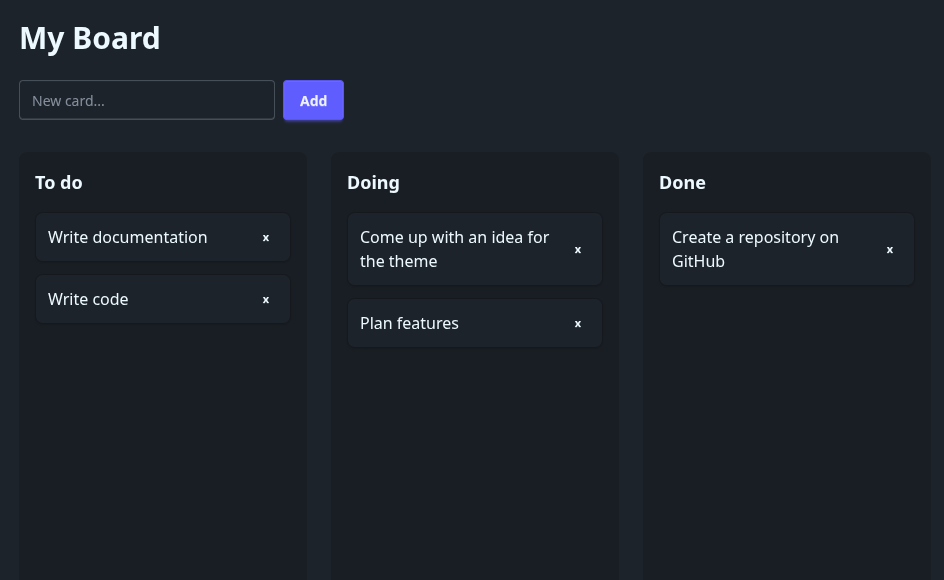

# Todos
 
A simple Trello-style board for keeping track of tasks. You can add cards, delete them, and drag them between **To do**, **Doing** and **Done**. Everything is saved in the browser, so your cards are still there after a refresh.


 
## Features
 
- Add cards with the button or by pressing Enter
- Delete cards with the ✕ button
- Drag and drop cards between columns and reorder them
- Cards and their positions are saved with localStorage
- Dark theme with hover effects and smooth drag animations
## Built with
 
- **HTML** and **JavaScript** (no framework)
- **Tailwind CSS** + **daisyUI** for styling
- **SortableJS** for drag and drop
## What I did
 
I built this project step by step as a portfolio piece while learning web development:
 
1. Set up the page layout with three columns using Tailwind and daisyUI
2. Made new cards appear when you click Add or press Enter
3. Added a delete button to each card
4. Saved the cards to localStorage so they survive a page refresh
5. Added drag and drop between columns with SortableJS, and saved each card's column and order
6. Polished the look with spacing, hover effects and a custom drop indicator
## What I learned
 
- **DOM manipulation:** creating and removing elements with `createElement`, `appendChild` and `remove()`
- **Events:** using `addEventListener` for clicks and key presses, and moving shared code into functions
- **Saving data:** `localStorage` only stores text, so I used `JSON.stringify` and `JSON.parse` to save and load an array of cards
- **Keeping data and the page in sync:** each card has a unique id, so deleting or moving a card updates the right item
- **Working with a library:** setting up SortableJS and fixing laggy dragging caused by CSS transitions
- **Tailwind CSS:** spacing (`p`, `m`, `gap`), flexbox layouts, and theming with daisyUI
- **Debugging:** finding typos in class names, duplicate ids and wrong file paths with the browser DevTools
- **Git and GitHub:** setting up a repo and pushing my project
## Run it locally
 
Download or clone the repo and open `index.html` in your browser. No install needed.
 
```bash
git clone https://github.com/Sh4dwDev/Todos.git
```
 
## Future ideas
 
- Edit a card's text by double-clicking it
- Add, rename and delete columns
- Card colours or labels
- Rebuild it in React
 